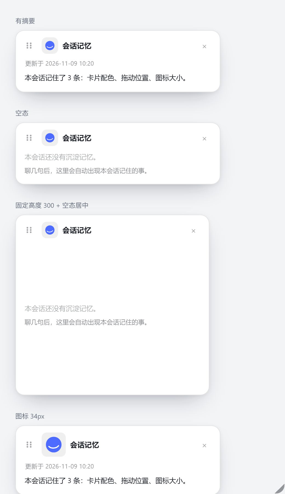
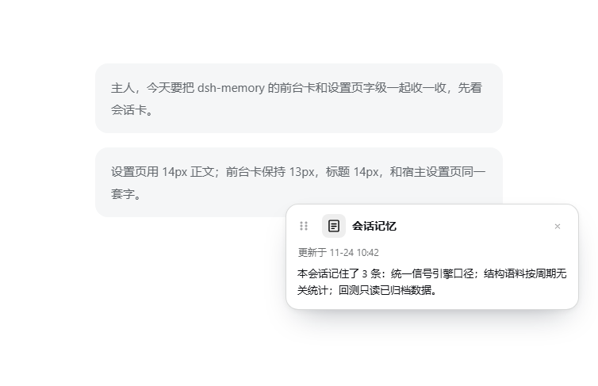
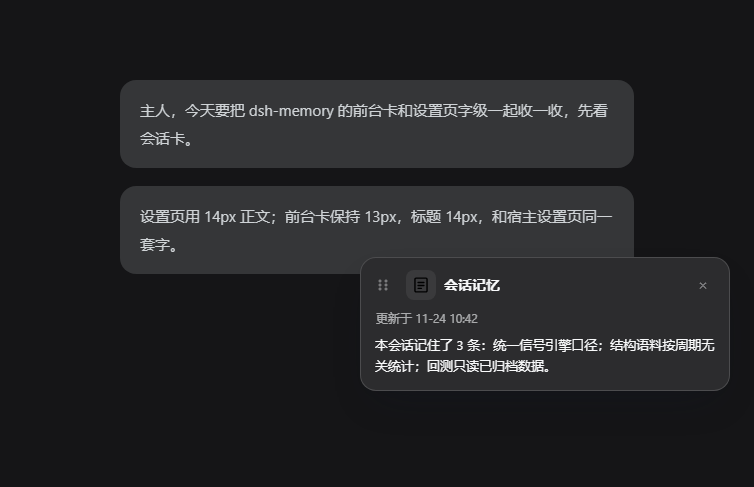
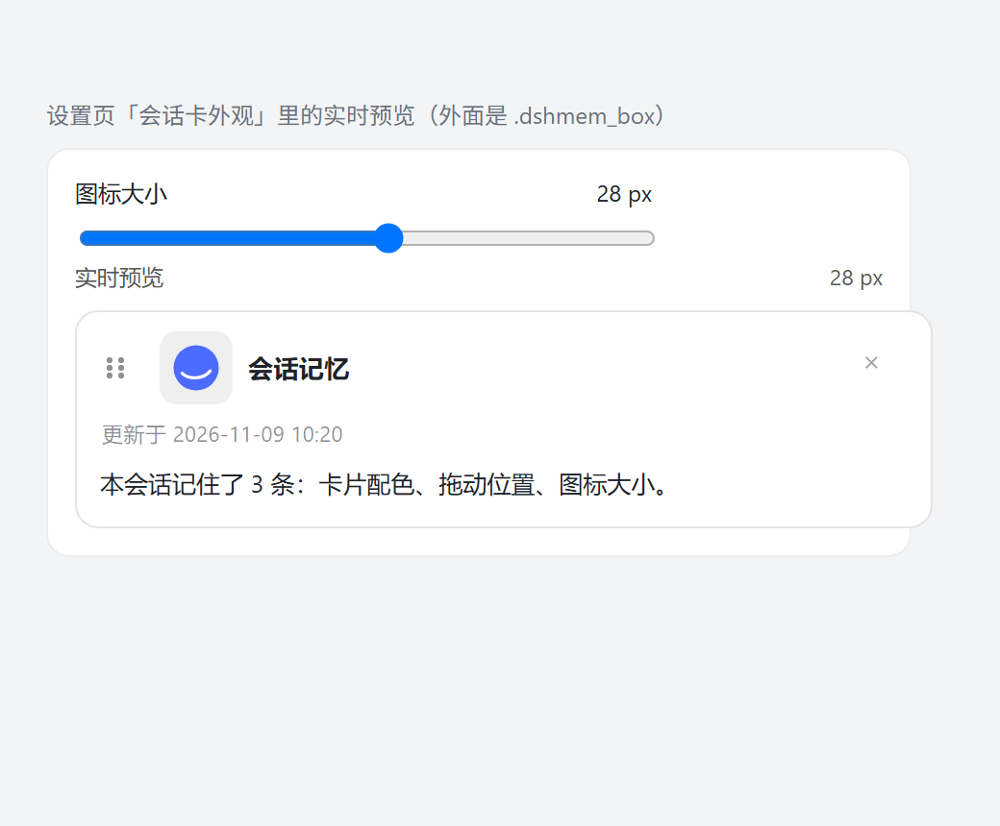
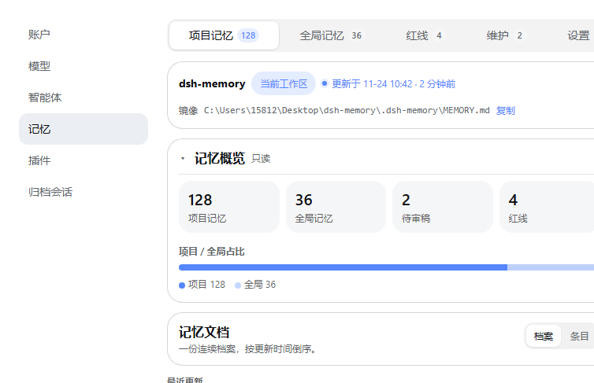
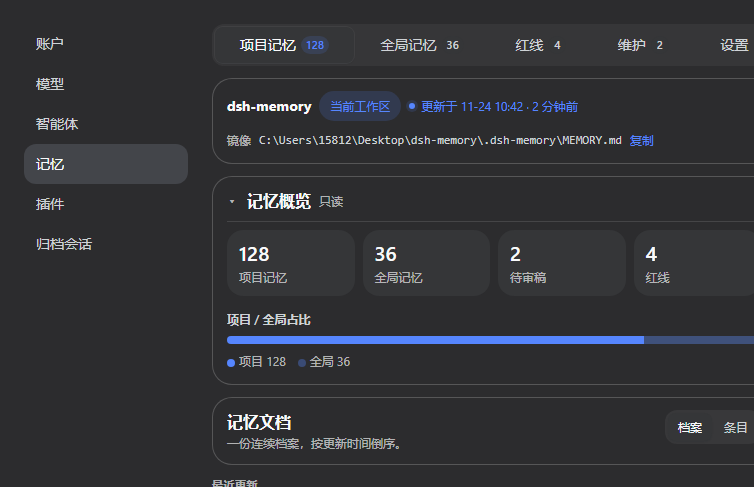
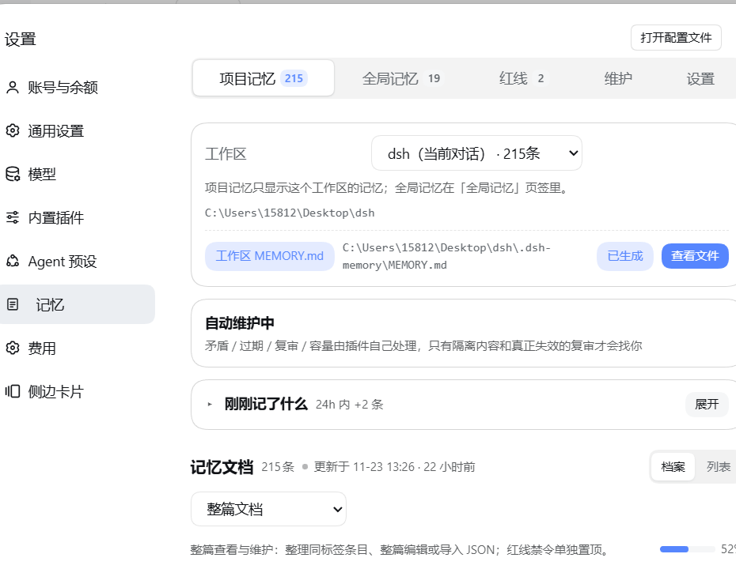
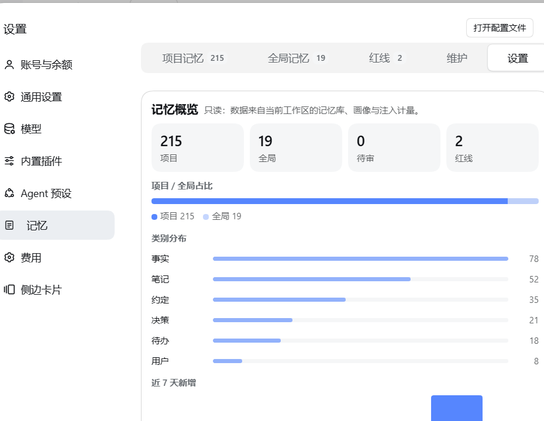
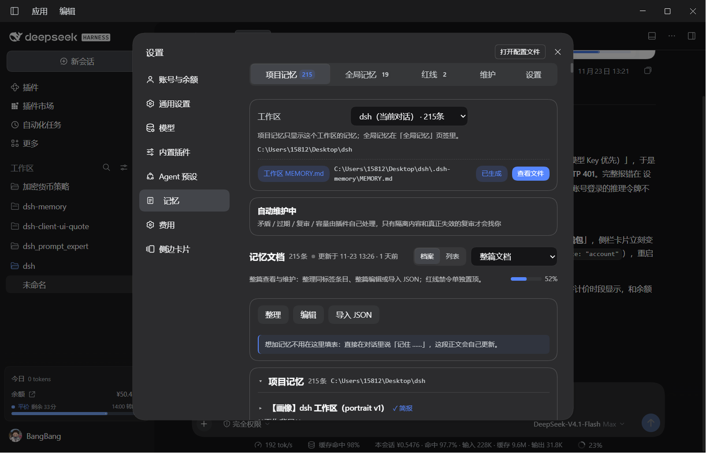
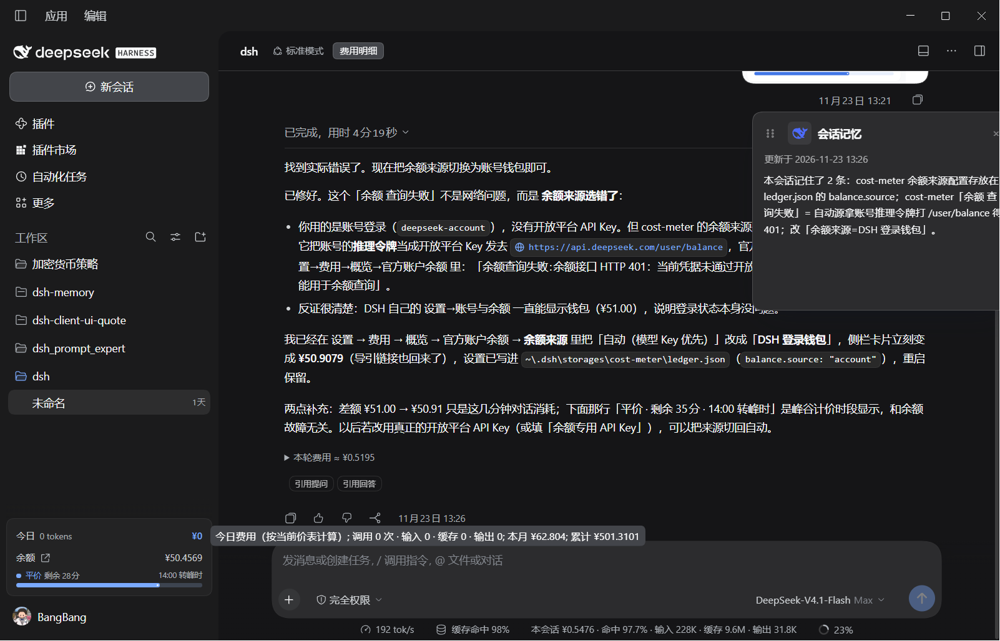

# dsh-memory 兼容性与 UI 统一自查报告

- 日期：2026-11-24
- 插件：`@bangbang-03/dsh-memory` `0.10.0`
- 基线宿主：DSH Desktop `0.2.2-rc.5`（Node `24.21.0` / Electron `44.7.0` / pnpm `11.28.5`）
- 项目根：`C:\Users\15812\Desktop\dsh-memory`（指向 `C:\Users\15812\Desktop\dsh\dsh-memory` 的 junction）

## 一、结论

**本轮自查已完成，代码、兼容元数据、全量测试和真机加载均已通过；未发现会导致启动失败、崩溃或数据损坏的 P0 问题。** 共确认并修复 5 个 P1 级真实问题、10 个 P2 级体验/健壮性问题（含第三轮新增的 1 个 P1、第四轮新增的 2 个 P2：深色选中态与版本链取消归档）；前台会话记忆卡与后台「记忆」设置页已统一字体、层级、间距、圆角和卡片材质。

当前状态：

| 项目 | 状态 | 关键证据 |
|---|---|---|
| 宿主 0.2.2 兼容性 | 通过 | app.asar 内 0.2.2 源码核对 + 真机加载 |
| 主题令牌 | 通过（修正 2 处错名） | `state-warn-primary`、`bg-base` 等已替换 |
| 真实 bug | 已修复 5 个 P1 + 10 个 P2 | `lib/client.js` 427 行、`lib/store.js` 87 行变更 |
| 前台/后台 UI | 已统一 | 同一字体栈、同一层级比例、同一材质与圆角体系；深色选中态已单独校准 |
| 全量测试 | 通过 | 15 个套件 / 724 条断言；Node 22 与 Node 24 双跑 |
| 真机验证 | 通过 | 0.2.2-rc.5 加载、设置页、HUD、越界坐标回收、浅色/深色切换与深色 HUD |
| 交付 | 报告与截图已落盘 | 本文件 + `docs/audit-assets-2026-11-24/` |
| Git | **未 commit、未 push** | 7 个已跟踪文件修改；报告、截图、`.idea`、`.probe` 未跟踪 |

> 版本号仍为 `0.10.0`，本轮不发布、不改 `dsh` 版本范围；等主人验收后再决定是否 commit。

## 二、环境与审计口径

### 2.1 为什么以 app.asar 为准

本机桌面版是 `D:\DSH\DeepSeek Harness.exe` `0.2.2-rc.5`，但 `C:\Users\15812\.dsh\profiles\node_modules\@deepseek-ai` 下的服务端包仍是 `0.2.1-rc.5`。如果直接读 profile 的 `node_modules`，会把 0.2.1 的 API 当成 0.2.2 来判，结论不可信。

本轮从 `D:\DSH\resources\app.asar` 抽取了 0.2.2 的以下源码做契约核对：

- `dsh-system-prompt`
- `dsh-tools`
- `dsh-agent-loop`
- `dsh-session`
- `dsh-host-webserver`
- `dsh-client-ui-layout`
- `dsh-client-ui-settings-general`
- `dsh-client-ui-theme`

真机加载验证则直接使用桌面版运行时，不依赖 profile 里的旧包。

### 2.2 真机环境

| 项 | 值 |
|---|---|
| DSH Desktop | `0.2.2-rc.5` |
| Node | `24.21.0` |
| Electron | `44.7.0` |
| pnpm | `11.28.5` |
| hostProtocolVersion | `4` |
| 初始视口 | `1282 × 822`，DPR `1.25` |
| 截图窗口 | `1272 × 800`（为完整取图移动过窗口） |
| 插件依赖 | `"@bangbang-03/dsh-memory": "link:C:/Users/15812/Desktop/dsh/dsh-memory"` |

## 三、兼容性自查

### 3.1 宿主 API 契约

| 宿主契约 | 0.2.2-rc.5 结论 | 插件用法 | 验证 |
|---|---|---|---|
| `systemPrompt.section(...)` | 存在且签名未变 | 注入记忆系统提示 | 单测 + 真机会话 |
| `tools/pre-execute` waterfall | 存在；`ctx.waterfall(carrier, "tools/pre-execute", exec, next)` 未变 | 工具执行前拦截/注入 | 单测 |
| `agent/pre-step` | 存在；`(payload, next)` 未变 | 每步前同步 | 单测 |
| `session/event` | 存在；`(session, event)` 未变 | 会话事件同步 | 单测 |
| `webServer.register(...)` | 存在；`{ kind, path, handler/resource }` 未变 | HTTP API | 真机设置页数据加载 |
| `settings.section` | 存在；返回 `{ close }` 未变 | 注册「记忆」设置页 | 真机 nav 出现「记忆」 |
| `shell.overlay` | 存在；list/root 槽位可用 | 挂载前台会话记忆卡 | 真机 HUD 渲染 |
| `ctx.locale.register/bind` | 存在 | 中英文文案 | 单测 |
| `ctx.slots.inject/register` | 存在 | nav / 内容槽位 | 真机设置页渲染 |

**结论：本轮插件使用的契约在 0.2.2-rc.5 全部成立，没有因宿主升级导致的启动失败或 API 缺失。**

### 3.2 主题令牌错配

审计发现两处宿主令牌名写错。因为都有字面回退，不会整块消失，但深色下颜色会偏离宿主：

| 错误写法 | 正确写法 | 影响 | 状态 |
|---|---|---|---|
| `--dsw-alias-state-warning-primary` | `--dsw-alias-state-warn-primary` | 警示色回退到 `#d97706`，深色下发闷 | 已全量替换 |
| `--dsw-alias-bg-primary` | `--dsw-alias-bg-base` | 透明/白色回退错误，深色下底色不跟随 | 已全量替换 |

同时补入宿主 0.2.2 的真实材质令牌：

- `--dsw-alias-settings-card-fill`：设置卡片底，等价 `bg-layer-2`
- `--dsw-alias-settings-card-stroke`：设置卡片 0.5px 描边，等价 `border-l4`
- `--dsw-alias-bg-module-platform`：卡内模块/凹槽底
- `--ds-font-family-code`：代码字体，末尾含 PingFang SC / Microsoft YaHei，不带裸 `monospace`

### 3.3 版本与兼容元数据

- `package.json` 的 `dsh` 范围：`>=0.2.0-rc.2 <0.3.0-0`
- `dshReleases` 现为 6 条：`0.2.0-rc.2` / `0.2.1-rc.3` / `0.2.1-rc.4 unknown` / `0.2.1-rc.5` / `0.2.2-alpha.2 unknown` / `0.2.2-rc.5`
- README 兼容表同步 6 行，`0.2.2-rc.5` 标注「当前桌面版，已真机验证」
- `node tools/check-compat.mjs` 输出：`range=>=0.2.0-rc.2 <0.3.0-0，releases=6 条，README 表=6 行`

**说明：** `0.2.2-rc.5 -> compatible` 的依据是「真机加载 + 设置页完整渲染 + 浅色/深色切换 + 深色 HUD + 全量单测」，不是完整回归矩阵。发布前若要更严格，应补 30 分钟浸泡与多窗口验证。

## 四、Bug 自查与修复

### 4.1 分级总表

| ID | 等级 | 问题 | 根因 | 修复 | ROI |
|---|---|---|---|---|---|
| B1 | P1 | HUD 保存坐标越界，整个胶囊跑出屏幕 | 只持久化坐标，没有按当前视口夹回 | 新增 `hudFitPos()`，挂载/开关/图标尺寸/窗口 resize/缩放结束时夹回 8px 边距并回写 | 高：直接恢复核心入口可见性 |
| B2 | P1 | 点一下缩放把手不拖动，也会把高度写成固定值 | `finish` 无条件 POST；未区分「点击」与「拖动」 | 2px 阈值分别记录 `movedWidth` / `movedHeight`；未移动只清本地覆盖 | 高：避免误改用户配置 |
| B3 | P1 | 只横向拖宽，却把 auto 高度钉死 | 保存时直接取 `next.height` | 未移动的维度沿用原配置（0 = 自适应） | 高：保持卡片自适应 |
| B4 | P1 | 浅色下卡片材质反了：白面板 + 灰卡；宿主描边令牌被覆盖 | `--dshmem-surface` 用了 `bg-module-platform`；`--dshmem-card-line` 两条声明，后一条 `color-mix` 覆盖宿主令牌 | 改为 `settings-card-fill` 优先、`settings-card-stroke` 单一声明；浅色白卡、深色深卡 | 高：视觉与宿主一致 |
| B13 | P1 | HUD 缩放手柄一按下就抛 `ReferenceError`，缩放完全不可用 | `startResize` 读取 `settings?.hudWidth/hudHeight`，但 `settings` 是设置页 `MemorySection` 的局部 state；HUD 在插件闭包里没有这个绑定 | 改用当前渲染已算好的 `look.width/height`（来自 `activeBrief` + `hudLookFrom`） | 高：恢复缩放，消除运行时报错 |
| B14 | P2 | 深色下选中页签/分段块与轨道几乎同色，选中态消失 | 轨道是 `card + 5% label`（深色约 `#363638`），选中块用 `bg-layer-3`（`#353638`），只差 1–2 RGB；分段轨 6% 叠加同理 | 增加 `:root[data-ds-theme-source="dark"]` 覆盖，选中块用宿主导航选中态 `--dsw-specific-sidebar-nav-item-active`（`#43454a`）+ 14% ring；浅色仍保留白底浮起 | 中：深色可读性，不影响浅色 |
| B15 | P2 | 取消归档旧版本只翻 `archived` 位，旧结论与新结论双活 | `update({archived:false})` / `bulk unarchive` 没处理 `supersededBy`；旧条恢复后仍带失效窗口，简报与检索会同时看到两端 | 新增 `reopenRecord()`：旧端恢复时收起新端，新端恢复时收起旧端并补回 `supersededBy`；`bulk` 同时选两端返回 `chain_conflict` | 高：防旧结论重新进入注入，版本链不被绕过 |
| B5 | P2 | 时间线 sticky 日期条透明，内容从日期行下透出 | `bg-primary` 不存在，回退 `inherit` | 改用 `--dshmem-surface` + 正确的 `bg-base` 回退 | 中：滚动可读性 |
| B6 | P2 | 路径文件名被断成 `MEMOR` / `Y.md` | 整段路径单节点 + `word-break:break-all` | `pathNode()` 拆分目录与文件名；文件名 `overflow-wrap:anywhere` | 中：路径可读、可复制 |
| B7 | P2 | 设置页 HUD 实时预览字体退化成 14px | `--dshmem-hud-fs-*` 只定义在 `.dshmem_hud`，预览不在该子树 | 选择器合并为 `.dshmem_hud,.dshmem_hudPreview` | 中：预览与真卡一致 |
| B8 | P2 | 预览卡固定 `width:100%`，滑杆 240px 时显示 529px | inline 样式写死 `100%` | 改为 `width:${previewLook.width}px;maxWidth:100%` | 中：预览不再误导 |
| B9 | P2 | 同一张卡里字段标签 14px / 12px 混用 | `.dshmem_lbl` 与 `.dshmem_fieldLabel` 两套 | 统一 14/22；HUD 计数徽标 10px 提到 11px | 中：层级一致 |
| B10 | P2 | 14px 页签在 559px 内容宽里贴边、计数拥挤 | 只有 `gap`，没有内边距与溢出策略 | 页签 10px 横向 padding、不换行、`overflow-x:auto` | 中：窄面板可用 |
| B11 | P2 | `copyText()` 兜底异常时临时 `textarea` 留在 DOM | `execCommand` 分支无清理保证 | `try/finally` 移除节点 | 低：防止长期累积 |
| B12 | P2 | 缩放监听可能残留，失焦/多指重复保存 | 无 `pointercancel`/`blur` 收尾，`finish` 不幂等 | `resizeRef` + 指针捕获 + 幂等 `finish` + `pointercancel` + `window blur` 清理 | 中：避免监听泄漏与重复写 |

### 4.2 重点问题说明

#### B1 HUD 坐标越界（真机发现）

真机视口 `1282×822` 时，旧 localStorage 坐标 `left=1647`，HUD 整个跑到屏幕右侧之外。只靠 CSS `right/bottom` 无法纠正已持久化的坐标。

修复：

- `hudFitPos(pos, width, height)` 计算当前视口允许范围，留 8px 边距；
- 挂载、`open`/`iconSize` 变化、`window resize` 时执行；
- 缩放结束时按新尺寸再夹一次，避免放大后右缘越界；
- 夹回后的坐标回写 localStorage。

真机结果：坐标从 `1647` 收回到约 `1090–1130`，胶囊恢复可见。

#### B2/B3 缩放配置写入

缩放把手原来在 `pointerup` 后无条件保存。即使只是单击，也会把当前高度写进配置；横向拖动时也会顺手把 auto 高度写成固定值。

修复后：

- `startResize` 记录起点与 2px 阈值；
- `movedWidth` / `movedHeight` 分别标记是否真正拖动；
- 两者都没动：只清本地覆盖，不写配置；
- 只动宽：保存宽度，高度沿用原配置；只动高：反之；
- `pointercancel`、`window blur`、重复 `pointerup` 均走幂等 `finish`。

#### B4 卡片材质

宿主设置卡的真实材质是：

- 卡面：`settings-card-fill` → `bg-layer-2`（浅色纯白，深色 `rgb(44,44,46)`）
- 描边：`settings-card-stroke` → `border-l4`，0.5px
- 卡内模块：`bg-module-platform`（浅色 `rgb(245,246,247)`，深色 `rgb(53,54,56)`）

旧实现把 `--dshmem-surface` 指向 `bg-module-platform`，浅色下变成「白面板 + 灰卡」，正好和宿主相反；同时 `--dshmem-card-line` 写了两条同名声明，后一条 `color-mix` 覆盖了宿主描边。现在改为宿主优先的单一声明，浅色/深色都与宿主同款。

#### B13 HUD 缩放引用未绑定变量

第三轮静态审阅发现：`startResize` 里的 `baseWidth/baseHeight` 直接读 `settings?.hudWidth/hudHeight`，但 `settings` 只存在于后台 `MemorySection` 的组件作用域；`SessionMemoryHud` 是插件闭包里的另一个组件，没有这个绑定。按下缩放把手时，这一行会先抛 `ReferenceError`，后面的拖动与保存都不会执行。

修复：改用 HUD 当前渲染已经算好的 `look.width` / `look.height`。它来自 `/session-brief` 下发的外观 + `hudLookFrom()` 的夹取结果，既避开了未绑定变量，也保证“横向拖动沿用原高度”的基准是用户当前看到的卡片尺寸。

> 这是静态可证的引用错误；插件单测没有覆盖 HUD 指针事件，所以 724 条断言一直绿。已补 `node --check` 与全量回归，并完成真机回落验证（见 7.2）。

#### B14 深色选中态与轨道同色

第四轮真机切到深色时发现：页签轨道最终是 `settings-card-fill` 上叠 5% `label-primary`，深色合成约 `#363638`；选中块用 `bg-layer-3`，深色正好 `#353638`。两者只差 1–2 RGB，深色下几乎看不出哪个页签是当前页；分段控件 6% 叠加同理。浅色下选中块是白底，问题不出现。

修复：只在深色主题下覆盖选中态，使用宿主自己的导航选中令牌 `--dsw-specific-sidebar-nav-item-active`（浅色 `#ebeef2` / 深色 `#43454a`），并把选中环提到 14%；浅色保持原来的白底浮起与 6% 环。这样不引入新的主题假设，也保留浅色已验收的视觉。

#### B15 取消归档绕过版本链

`update(id, { archived: false })` 原来只把归档位翻回去，`supersededBy` / `validUntil` / `invalidatedBy` 都原样保留。结果：从旧版本点「取消归档」后，旧条虽然回到 active，但仍被当成「已失效事实」降权，且新条也仍在 active——简报、检索、镜像会同时看到互相推翻的两条结论。

修复：

- 新增 `reopenRecord()`，取消归档时按版本链方向处理：
  - 旧端（带 `supersededBy`）：恢复旧条并收起新条；
  - 新端（带 `supersedes`）：恢复新条并收起旧条，同时给旧条补回 `supersededBy` / `validUntil`，防止下次从旧端恢复时找不到链；
  - 清掉 `archiveReason`，重开 `validUntil` / `invalidatedBy`，避免恢复后仍被静态降权。
- `bulk unarchive` 改为逐条走同一语义；同一链两端同时选中时返回 `chain_conflict`，不做半套写入。
- `POST /bulk` 现在会把 `chain_conflict` 映射为 400，不再假装成功。
- `lib/policy.js` 的 TODO 同步移除，改为记录链恢复语义。

**验证**：`store` 套件新增断言覆盖旧端/新端取消归档与批量冲突；`api` 套件在原有 `/update`、`/bulk` 路径上全绿。

## 五、UI 统一

### 5.1 字体层级

设置页与 HUD 使用同一字体栈，层级比例一致；HUD 是覆盖在对话上的浮层，基准字号刻意比设置页小 1px，避免遮挡正文。

| 层级 | 设置页 | HUD | 用途 |
|---|---|---|---|
| 区块标题 | 16 / 24 | 14 / 20 | 分区标题、卡片标题 |
| 正文 | 14 / 22 | 13 / 1.62 | 条目正文、文档正文、HUD 摘要 |
| 辅助 | 12 / 18 | 12 / 18 | 时间、计数、字段说明 |
| 注释 | 11 / 16 | 11 / 16 | 页脚、脚注、极弱信息 |
| 数字 | 20 / 1.3 | — | KPI 数字 |
| 代码/路径 | 12 / 18 等宽 | — | 路径、JSON 预览、红线 |

字体：

- 全局：`font-family: var(--dsw-font-family, inherit)`
- 代码：`var(--ds-font-family-code, ui-monospace, "SF Mono", ..., "Microsoft YaHei", monospace)`
- 不再让 Windows 中文落到 SimSun。

### 5.2 间距、圆角、材质

| 项 | 设置页 | HUD | 说明 |
|---|---|---|---|
| 卡片圆角 | 20px（`--dsw-radius-xl`） | 16px（`--dsw-radius-lg`） | 设置页大卡；HUD 浮层略小 |
| 卡内凹槽 | 16px（`--dsw-radius-lg`） | — | 工具区、证据区 |
| 输入/按钮 | 12px（`--dsw-radius-md`） | — | 控件 |
| 小件 | 8px（`--dsw-radius-sm`） | 8px | 图标按钮、抓手 |
| 卡片内边距 | 12px 14px | 12px 14px 14px | 4px 栅格 |
| 卡片描边 | 0.5px `settings-card-stroke` | 0.5px 半透明 currentColor | 同材质语言 |
| 卡面 | `settings-card-fill`（白/深灰） | `bg-layer-2` 或用户自定义 | HUD 允许自定义色 |
| 卡内底 | `bg-module-platform`（浅灰） | 半透明叠加 | KPI/凹槽 |

间距统一走 4px 栅格：`4 / 8 / 12 / 16 / 24`；页签轨道 12px 圆角、按钮 36px 高 / 8px 圆角；普通按钮 34px 高；输入框 12px 圆角。

### 5.3 视觉验收

**前台会话记忆卡（改造前 → 改造后）**

改造前：卡片圆角偏大、内边距偏松、辅助字号偏大，和设置页不是一套。



改造后：标题 14/20、正文 13、辅助 12、注释 11，16px 圆角、0.5px 描边，和设置页同一字体栈。





**后台「记忆」设置页**

改造前 HUD 预览卡：外层圆角、灰底、字号层级不统一。



改造后：白卡 + 0.5px 描边 + 灰色 KPI 瓦片，页签与字段标签统一 14px，20px 卡片圆角。





**真机 0.2.2-rc.5（真实宿主，不是静态模拟）**

真机项目记忆页：路径拆成目录 + 文件名，`MEMORY.md` 不再被拆开。



真机「设置」页：记忆概览 KPI、页签、字段排版。



真机深色设置页：选中页签用宿主选中态 `#43454a`，与 `#363638` 轨道拉开层次。



真机深色 HUD：卡面 `rgb(44,44,46)`、文字 `rgb(249,250,251)`、0.5px 描边，透明度与位置沿用用户配置。



> 浅色真机截图已裁去左侧宿主设置导航，只保留记忆面板；深色两张为完整窗口截图。浅色原图是 `1272×800` 窗口，右缘略有裁切，属于取图窗口尺寸，不是面板布局溢出。静态预览由 `lib/client.js` 的真实 CSS + 宿主 0.2.2 `design-platform.css` / `base.css` 生成；真机截图用于验证实际加载、浅色/深色切换与深色 HUD。

## 六、新发现与遗留 issue（含第三、四轮）

本轮除修复上表 P1/P2，还确认了以下 issue。O3 已在第三轮顺手补齐；其余未纳入主流程，但建议排期：

| ID | 等级 | Issue | 现状/风险 | 建议 |
|---|---|---|---|---|
| O1 | P2 | `lib/policy.js` 的归档恢复缺 `supersededBy` 回滚链 | 已修（B15）：`update` / `bulk unarchive` 都按版本链方向恢复；同一链两端同时选中返回 `chain_conflict` | 不再单开 issue，回归测试已覆盖 |
| O2 | P3 | 0.2.2 已有官方 `settings.section.icon` 槽位，插件仍用 CSS 替换齿轮图标 | 当前 `span.navIcon > svg:first-child` 在 0.2.2 可命中；宿主未来改 nav DOM 可能失效 | 后续切官方槽位，避免与 `::before` 字形叠加 |
| O3 | P3 | 页签原有 `role=tab` / `aria-selected`，但缺方向键 / Home / End 与 `aria-controls` | 键盘用户要按 Tab 逐个跳过 5 个页签；读屏无法把 tab 与面板关联 | 第三轮已补 `onTabKeyDown`、`aria-orientation`、`aria-controls` 与唯一面板 id；真机方向键回归已通过 |
| O4 | P3 | 项目页 215 条记录全部挂载，内容高约 24,461px | 当前规模滚动正常；记录数继续增长会变重 | 到 500+ 条再评估虚拟列表，当前不提前优化 |
| O5 | P2（验证缺口） | 深色真机切换、深色 HUD 已完成；HUD 缩放与页签键盘已真机回归通过 | 仍缺 30 分钟浸泡与多窗口验证，不能把这两项写进已验证矩阵 | 发布前补一次 30 分钟浸泡 + 多窗口验证 |
| O6 | 决策项 | HUD 正文 13px vs 设置页正文 14px 是否有意分层 | 当前是刻意分层：浮层小 1px，避免遮挡对话；字体、比例、圆角、材质已统一 | 若主人要求完全同字号，HUD 提到 14px 后需重估卡片高度与换行 |
| O7 | P3 | 页签轨道 / 分段控件仍有重复 `background`：先写宿主 token，后写 `color-mix`，后者实际覆盖前者 | 和 B4 同类，但只是 5–6% 叠加，按色值推算浅色/深色与宿主模块底约差 1–3 RGB，视觉几乎无感；代码上宿主令牌不是单一来源 | 收敛为单条 `var(--dshmem-surface-strong)` / `var(...,color-mix(...))`，不必在本轮重拍截图 |

### 6.1 第三、四轮新增与纠正

- **B13（P1，已修并真机验证）**：HUD 缩放读取未绑定的 `settings`，按下把手即抛 `ReferenceError`；改用 `look.width/height`。真机模拟 `pointerdown → pointermove → pointerup` 已通过：卡片从 `270×208` 变为 `340×256`，`data-size=fixed`，无 `window error`。
- **B14（P2，第四轮已修）**：深色下页签/分段选中块与轨道几乎同色，选中态消失；用 `bg-layer-3` `#353638` 对 `#363638` 轨道只差 1–2 RGB。已改为深色使用宿主选中态 `#43454a`，浅色保持白底。
- **B15（P2，第四轮已修）**：取消归档只翻 `archived` 位，旧版本与新版本会双活；新增 `reopenRecord()` 按链方向恢复，批量两端同时选返回 `chain_conflict`。
- **O3（P3，已补并真机验证）**：页签原本已经有 `role=tab` / `aria-selected`，上一版报告写成“缺少”是误判；本轮补的是方向键 / Home / End 循环切换、`aria-orientation`、`aria-controls` 和唯一面板 id。真机发送 `ArrowRight` 后，焦点与 `aria-selected` 从「项目记忆」同步切到「全局记忆」。
- **O7（P3，未改）**：页签/分段控件重复 `background` 声明，宿主 token 被后一条 `color-mix` 覆盖；视觉差异小，先记录，不重拍截图。
- **纠正**：上一版报告把 `role=tab` 缺失列为 O3，属于核对不完整；本轮以代码为准修正。
- **未发现新的 P0**；第三轮新增 P1 只有 B13，第四轮新增 P2 为 B14、B15，均已修复；其余为 P3 与既有验证缺口。

## 七、验证记录

### 7.1 自动化

在项目根执行：

```powershell
node --check lib/client.js
node test/run-all.mjs
node tools/check-compat.mjs
git diff --check
```

结果：

- `node --check lib/client.js`：通过
- `node test/run-all.mjs`：**15 个套件通过，724 条断言；文档数字一致**；install 套件 **17 passed, 0 failed**
- Node `22.23.2` 与 DSH 自带 Node `24.21.0` 双跑，均为 15/724
- `node tools/check-compat.mjs`：`range=>=0.2.0-rc.2 <0.3.0-0，releases=6 条，README 表=6 行`
- `git diff --check`：无空白错误
- `package.json`：JSON 解析通过
- CSS 模板：**40,338 字符，`{` / `}` 各 283，最终深度 0，最小深度 0**

### 7.2 真机

- DSH `0.2.2-rc.5` 启动，插件客户端加载，无启动跳过/报错；
- 设置对话框 nav 含「记忆」，`.dshmem` 面板宽约 `559.2` CSS px；
- 项目记忆页真实渲染 215 条、内容高约 `24,461px`；
- 设置页 11 个 `.dshmem_box`，内容高约 `4,278px`；
- HUD 胶囊 `140×34`；
- HUD 实时预览、卡片宽度/高度滑杆、路径拆分均可见；
- 旧坐标 `left=1647` 经 `hudFitPos` 收回到约 `1090–1130`，胶囊可见；
- HUD 缩放真机模拟：`270×208 → 340×256`，`data-size=fixed`，坐标 `x1004 → x964`，`window.__dshErr` 为空；
- 设置页键盘真机回归：发送 `ArrowRight` 后焦点与 `aria-selected` 从「项目记忆」切到「全局记忆」，5 个页签的 `aria-controls` 全部指向 `#dshmem-memory-tabpanel`；
- 深色真机：html `data-ds-theme-source=dark`，页签选中块 `rgb(67,69,74)`（`#43454a`）对轨道约 `#363638`，分段控件同样；浅色切回后选中块仍为 `rgb(255,255,255)`；
- 深色 HUD 真机：卡面 `rgb(44,44,46)`、文字 `rgb(249,250,251)`、0.5px 描边，`window.__dshErr` 为空；
- 当前验证用 DSH 进程仍在运行；报告完成后可按需关闭。

> 补充：B13、页签键盘、缩放松手夹回、B14 深色选中态均已真机回归；仍未覆盖 30 分钟浸泡与多窗口，列入 O5 发布前复测。

> 真机截图期间 DSH 窗口曾自动隐藏/被其他窗口遮挡，CDP `Page.captureScreenshot` 多次超时；改用 Win32 `PrintWindow` / 屏幕捕获，并把窗口移到 `(0,0,1272×800)` 取得截图。该现象是取图环境问题，不是插件 UI 问题。

## 八、改动文件与交付

### 8.1 已修改（未 commit）

| 文件 | 变更 |
|---|---|
| `lib/client.js` | CSS 令牌/字级/圆角/卡片材质统一；`copyText` 清理；HUD 缩放并发与收尾；点击不拖动不写高度；横向拖动不钉死 auto 高度；HUD 越界坐标夹回；路径目录/文件名拆分；HUD 预览字体变量与宽度；表单标签 14px；HUD 缩放基准改用 `look`；页签键盘/ARIA；深色页签/分段选中态 |
| `lib/store.js` | `reopenRecord()`：取消归档按版本链方向恢复；清除失效窗口与归档原因；批量取消归档复用同一语义 |
| `lib/api.js` | `/bulk` 将 `chain_conflict` 映射为 400，不再假装成功 |
| `lib/policy.js` | 移除归档恢复的 TODO，改为记录链恢复语义 |
| `test/store.test.mjs` | 补旧端/新端取消归档与批量冲突断言（不新增套件数） |
| `package.json` | `dsh.compatibility.dshReleases` 增加 `0.2.2-rc.5: compatible` |
| `README.md` | 兼容表增加 `0.2.2-rc.5` 行，`0.2.2-alpha.2` 标 unknown |

`git diff --stat`：7 个文件，**401 insertions / 145 deletions**；其中 `lib/client.js` 427 行、`lib/store.js` 87 行、`test/store.test.mjs` 23 行。

`git status --short`：`M README.md`、`M lib/api.js`、`M lib/client.js`、`M lib/policy.js`、`M lib/store.js`、`M package.json`、`M test/store.test.mjs`、`?? .idea/`、`?? .probe/`；本轮新增报告与截图目录也是未跟踪状态。

### 8.2 交付物

- 本报告：`C:\Users\15812\Desktop\dsh-memory\docs\compat-ui-selfcheck-2026-11-24.md`
- 截图资产：`C:\Users\15812\Desktop\dsh-memory\docs\audit-assets-2026-11-24\`
  - `before-hud.png` / `before-panel.png`：改造前基线
  - `preview-hud-light.png` / `preview-hud-dark.png`：改造后静态预览
  - `preview-panel-light.png` / `preview-panel-dark.png`：改造后设置页预览
  - `real-memory-project.png` / `real-memory-overview.png`：真机 0.2.2-rc.5 浅色截图
  - `real-memory-dark.png` / `real-hud-dark.png`：真机深色设置页与深色 HUD

### 8.3 未做

- 未 `git commit`、未 `git push`；
- 未改版本号、未发版；
- 未改 `lib/index.js`；
- 未训练、未合成数据、未下载额外数据。

## 九、建议下一步

1. **验收 UI**：先看真机截图与静态浅色/深色预览，确认「HUD 13px / 设置页 14px」的分层是否接受；如果要完全同字号，改一个 token 后重测 HUD 高度。
2. **确认 commit**：本轮 7 个文件可拆成两个提交（UI/兼容性 + 版本链恢复）；报告与截图是否一起入库由主人决定。
3. **发布前补验证**：30 分钟浸泡 + 多窗口；深色真机与深色 HUD 已完成。如通过，再把 `0.2.2-rc.5` 的 compatible 标注保留。
4. **另开 issue**：`settings.section.icon` 官方槽位与页签重复 `background` 属 P3 技术债，不与本次修复混提。
